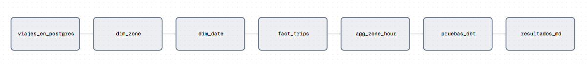
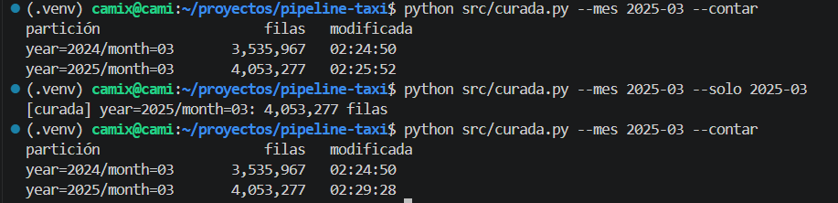

# Pipeline NYC Taxi

Pipeline batch reproducible que descarga, valida, limpia y modela los viajes de taxis
amarillos de Nueva York (TLC) de un mes asignado y del mismo mes del año anterior, y responde
seis preguntas de negocio con SQL sobre un modelo estrella.

- **Mes asignado:** 2025-03 (comparación contra 2024-03).
- **Integrantes:**
  - Suarez Camila Rosario 58143
  - Gonzalez Nahuel Gonzalo 56184
- **Repositorio:** https://github.com/Camila-0016/pipeline-taxi

## Cómo instalar y ejecutar

**Requisitos:** Python 3.10 o superior (probado con 3.14.4), `make`, Docker con Compose v2
y unos 3 GB de disco libres. Probado en Ubuntu 26.04 sobre WSL 2, en una notebook de 8 GB de RAM

```bash
git clone https://github.com/Camila-0016/pipeline-taxi.git
cd pipeline-taxi
python3 -m venv .venv
source .venv/bin/activate
pip install -r requirements.txt

make all MES=2025-03      # ejecuta todo el pipeline de punta a punta
make test                 # 12 tests automáticos (pytest)
```

`make all` levanta Postgres en Docker por su cuenta y no necesita que los datos estén incluidos
en el repositorio, los descarga. Cada etapa también se puede correr sola
(`make ingesta`, `make esquema`, `make calidad`, `make curada`, `make carga`, `make dbt`,
`make preguntas`). `make dagster MES=2025-03` ejecuta el mismo pipeline orquestado por Dagster.
`make down` apaga Postgres (los datos se conservan en un volumen de Docker).

**Notebook de 8 GB con WSL:** se recomienda crear `C:\Users\<usuario>\.wslconfig` con

```
[wsl2]
memory=5GB
swap=8GB
```

y reiniciar WSL (`wsl --shutdown`). Con el tope por defecto, la corrida junto con el editor
abierto se quedó sin memoria (ver "Tiempo de ejecución y memoria")

## Arquitectura

```
 TLC (CloudFront)
      |
 1 ingesta ----> data/raw/yellow/year=AAAA/month=MM/*.parquet, zonas, data/control/ingestion_log.csv
 2 esquema ----> data/staging/yellow_unificado_{mes}.parquet     (contrato: contracts/yellow_schema.yaml)
 3 calidad ----> data/staging/yellow_aceptado_{mes}.parquet
                 data/quarantine/yellow_cuarentena_{mes}.parquet
                 data/reports/calidad_{mes}.json                 (reglas: contracts/quality_rules.yaml)
 4a curada ----> data/curated/yellow/year=AAAA/month=MM/part-0.parquet   (Parquet Hive, columnas derivadas)
 4b carga -----> Postgres: raw.yellow_aceptado, raw.yellow_cuarentena, raw.zonas
 5 dbt --------> staging -> intermediate -> marts: dim_zone, dim_date, fact_trips, agg_zone_hour
 6 preguntas --> RESULTADOS.md                                   (consultas en sql/preguntas/)
```

La validación de calidad es la compuerta del pipeline: separa las filas aceptadas de las
rechazadas. Todo lo que está en `data/` se regenera y no se versiona



### Estructura del repositorio

| Ruta | Contenido |
|---|---|
| `src/` | `ingesta.py`, `esquema.py`, `calidad.py`, `curada.py`, `cargar_postgres.py`, `preguntas.py`, `orquestacion.py` (Dagster) |
| `contracts/` | `yellow_schema.yaml` (esquema destino) y `quality_rules.yaml` (reglas de calidad) |
| `sql/modelo/` | modelo dbt: `staging/`, `intermediate/`, `marts/` (un modelo por archivo) |
| `sql/preguntas/` | las 6 preguntas de negocio, una consulta por archivo, más sus interpretaciones |
| `dbt/` | configuración de dbt (`dbt_project.yml`, `profiles.yml`) |
| `tests/` | 12 tests de pytest |
| `Makefile`, `docker-compose.yml` | ejecución con un solo comando y Postgres 16 |
| `RESULTADOS.md` | respuestas, consulta e interpretación de cada pregunta (generado por `make preguntas`) |

### Herramientas usadas y no usadas

Se usaron Python, DuckDB (limpieza pesada de millones de filas con tope de memoria), Parquet,
Postgres 16 en Docker, dbt (modelo por capas y tests) y Dagster (orquestación).
Airbyte se reemplazó por una ingesta propia (`ingesta.py`): su despliegue es muy pesado para
una notebook de 8 GB y la consigna pide hash, reintentos y registro de control, que se
controlan mejor en código propio. No se usó Grafana, porque las preguntas se responden por SQL

## Decisiones

### Parte 1: Ingesta

- **Idempotencia con hash SHA-256.** Un archivo no se vuelve a descargar si ya existe y su hash
  coincide con el de una descarga registrada como `ok`. Si el archivo cambia o se corrompe, el
  hash no coincide y se descarga de nuevo (cubierto por tests).
- **Descarga atómica.** Se baja a un archivo `.part` y recién al terminar se renombra, para no
  dejar nunca un archivo a medias que parezca válido.
- **Reintentos.** Hasta 3 intentos con espera creciente (2 s y 4 s). Si sigue fallando se
  registra el error en el log y el programa termina con código de salida 1.
- **Registro de control.** `data/control/ingestion_log.csv` guarda archivo, URL, filas, bytes,
  hash, fecha y hora, estado y detalle del error.

### Parte 2: Esquema

- **Contrato en un archivo versionado** (`contracts/yellow_schema.yaml`), no en el código.
  Define nombre de origen, nombre destino (snake_case), tipo y si la columna es requerida.
- **`cbd_congestion_fee` en 2024 vale NULL, no 0.** Ese cargo no existía en 2024: NULL (no
  aplica) es más fiel que 0 (se cobró cero), y evita mezclar viajes de 2024 con viajes de 2025
  que realmente pagaron 0 al calcular porcentajes.
- **Columna nueva que no está en el contrato:** no hace fallar el pipeline, pero no se carga en
  silencio: queda en el reporte de esquema y se ignora hasta que se agregue al contrato.
- **Columna requerida faltante:** el pipeline falla. **Tipo distinto:** se reporta y se convierte
  al tipo del contrato; si no se puede, falla con un error claro.
- **Unificación:** se agrega `archivo_origen`. El pipeline verifica que las filas unificadas sean
  igual a la suma de las de los archivos de origen (4.145.257 + 3.582.628 = 7.727.885).

### Parte 3: Calidad de datos

- **12 reglas en un archivo versionado** (`contracts/quality_rules.yaml`), cada una con
  identificador, descripción, severidad, umbral y justificación con datos reales. Se eligió
  **rechazo** para lo imposible o lo que rompe el pipeline (fechas fuera de mes, bajada no
  posterior a la subida, distancia o velocidad absurdas, importes negativos, duraciones de más de
  24 h, zonas inexistentes, duplicados) y **advertencia** para lo sospechoso pero que representa
  ingreso real (distancia 0, pasajeros nulos o 0, zona desconocida, tarifa negativa).
- **Pasajeros nulos o 0 es advertencia, no rechazo.** Coincide exactamente con `payment_type = 0`
  y `ratecode_id` nulo; rechazarlos descartaría el 13% de las filas de 2024 y el 22,7% de 2025 y
  falsearía la comparación entre meses.
- **Reglas propias descubiertas explorando los datos:** R09 (velocidad > 100 mph), R10 (zonas 264
  y 265, que no son lugares reales), R11 (duración > 24 h) y R12 (tarifa negativa).
- **El proveedor 7 (solo en 2025)** registra siempre bajada igual a subida (21.481 filas): esas
  filas quedan en cuarentena por R02.
- **Cuarentena:** conserva la fila (ya normalizada), su archivo de origen y la lista de reglas de
  rechazo violadas (por ejemplo `R02,R04`). Las advertencias se marcan en la columna `flags` de
  las filas aceptadas.
- **Reconciliación:** si las filas leídas no son iguales a aceptadas más cuarentena, el pipeline
  falla con código de salida 1.

Resultado por mes (una fila puede violar más de una regla, por eso las reglas suman más que la
cuarentena):

| Regla | Severidad | 2024-03 | 2025-03 |
|---|---|---:|---:|
| R01 subida fuera del mes | rechazo | 23 | 33 |
| R02 bajada no posterior a subida | rechazo | 1.128 | 22.280 |
| R03 distancia no positiva | advertencia | 87.168 | 103.722 |
| R04 distancia > 100 mi | rechazo | 122 | 214 |
| R05 importe total negativo | rechazo | 44.311 | 68.686 |
| R06 pasajeros nulo o 0 | advertencia | 466.562 | 939.378 |
| R07 zona inexistente | rechazo | 0 | 0 |
| R08 fila duplicada | rechazo | 0 | 0 |
| R09 velocidad > 100 mph | rechazo | 1.178 | 961 |
| R10 zona 264 o 265 | advertencia | 35.374 | 28.415 |
| R11 duración > 24 h | rechazo | 20 | 11 |
| R12 tarifa negativa | advertencia | 58.464 | 208.724 |
| **Leídas** | | 3.582.628 | 4.145.257 |
| **Aceptadas** | | 3.535.967 | 4.053.277 |
| **Cuarentena** | | 46.661 (1,30%) | 91.980 (2,22%) |

### Parte 4: Transformación y almacenamiento

- **Capa curada en Parquet particionado estilo Hive** por año y mes:
  `data/curated/yellow/year=2025/month=03/part-0.parquet`, comprimido con ZSTD.
- **Columnas derivadas:** fecha, hora y día de la semana de la subida, duración en minutos,
  velocidad en mph y propina como porcentaje de la tarifa (nula si la tarifa no es positiva).
- **Enriquecimiento con zonas:** barrio y nombre de zona de origen y de destino.
- **Reprocesar un mes reemplaza solo su partición.** Se escribe en una carpeta temporal, se
  verifica que las filas escritas igualen las esperadas y recién entonces se intercambia con la
  partición vieja. Si algo falla, la partición vigente queda intacta (cubierto por tests).
  `python src/curada.py --mes 2025-03 --solo 2025-03` reprocesa una sola partición.
- **Postgres:** la carga reemplaza las filas del mes procesado (columna `mes_proceso`) en lugar de
  agregarlas, así correrla dos veces da los mismos conteos.

**Demostración del reproceso por partición** (horas en UTC, la zona del entorno WSL):

| Partición | Filas antes | Modificada antes | Filas después | Modificada después |
|---|---:|---|---:|---|
| `year=2024/month=03` | 3.535.967 | 02:24:50 | 3.535.967 | 02:24:50 (intacta) |
| `year=2025/month=03` | 4.053.277 | 02:25:52 | 4.053.277 | 02:29:28 (reemplazada) |

```bash
python src/curada.py --mes 2025-03 --contar               # antes
python src/curada.py --mes 2025-03 --solo 2025-03         # reprocesa solo esa partición
python src/curada.py --mes 2025-03 --contar               # después
```



### Parte 5: Modelo y preguntas de negocio

- **Postgres 16 en Docker + dbt** con tres capas: *staging* (renombra, castea y deriva campos,
  como vistas), *intermediate* (velocidad y enriquecimiento con zonas, como vistas) y *marts*
  (el modelo estrella, como tablas físicas). 9 tests de dbt: unicidad y no nulidad de las claves
  y relaciones de `fact_trips` con `dim_zone` y `dim_date`.
- **Clave del hecho:** los datos no traen un identificador de viaje, así que `viaje_id` es un hash
  MD5 de siete campos del viaje. El test de unicidad pasa sobre los 7.589.244 viajes.
- **Dagster orquesta el pipeline** como un grafo de siete activos. Los modelos de dbt se encadenan
  (no corren en paralelo) para no competir por memoria en 8 GB y para que dos corridas de dbt no
  recreen la misma vista a la vez.

#### Granularidad de cada tabla

| Tabla | Una fila representa | Filas (2025-03 y 2024-03) |
|---|---|---:|
| `analytics.fact_trips` | un viaje aceptado | 7.589.244 |
| `analytics.dim_zone` | una zona de taxi (barrio y nombre) | 265 |
| `analytics.dim_date` | un día calendario, de la primera a la última fecha de viaje | 396 |
| `analytics.agg_zone_hour` | una zona de origen, en una fecha y una hora | 211.410 |
| `raw.yellow_aceptado` | un viaje aceptado, antes de modelar | 7.589.244 |
| `raw.yellow_cuarentena` | un viaje rechazado y las reglas que violó | 138.641 |

Las seis respuestas, con su consulta e interpretación, están en [RESULTADOS.md](RESULTADOS.md).

## Reproducibilidad

Se verificó clonando el repositorio en una carpeta nueva, sin datos ni entorno previo,
instalando con `requirements.txt` y ejecutando `make all MES=2025-03`:

- Terminó sin errores, `fact_trips` dio 7.589.244 filas y `RESULTADOS.md` salió idéntico al del
  proyecto original.
- Correr `make ingesta` de nuevo no vuelve a descargar nada (los tres archivos figuran como
  omitidos por hash coincidente).
- Los conteos de la carga a Postgres son iguales en corridas repetidas.

## Tiempo de ejecución y memoria

Medido en una Dell Inspiron 15 3535 (Ryzen 3 7320U, 8 GB de RAM), con WSL 2 limitado a 5 GB
(4,8 GB visibles) y 8 GB de swap.

| Corrida | Tiempo |
|---|---:|
| `make all MES=2025-03` desde un clon limpio (con descarga) | 7 min 1 s |
| `make all MES=2025-03` con archivos ya descargados | 6 min 32 s |
| `make dagster MES=2025-03` (pipeline orquestado) | 12 min 28 s |

El pico de memoria usada en WSL fue de **3.422 MB** (partiendo de 555 MB), muestreando `free -m`
cada 3 segundos durante `make all`. Incluye DuckDB, Postgres y el resto del sistema. Espacio en
disco de `data/`: raw 125 MB, staging 327 MB, curated 193 MB, quarantine 3,2 MB.

Los pasos de DuckDB usan un tope de memoria (2 GB en calidad, 3 GB en la capa curada, con
derrame a disco) y Postgres se levanta recién en la etapa de carga. En una primera corrida con
el editor abierto el proceso fue terminado por falta de memoria, y la capa curada se quedó sin
memoria con 8 hilos: se redujo a 4 hilos y se desactivó la preservación del orden de inserción.
`make dagster` tarda más porque cada activo lanza su propio proceso, y no se midió en las mismas
condiciones que `make all`.

## Limitaciones conocidas

- Ante un error HTTP 403 o 404 se reintenta igual, aunque no se resuelva reintentando. Se podría
  limitar el reintento a errores de red o del servidor.
- Las filas del proveedor 7 quedan en cuarentena por R02 aunque podrían tener tarifa e importe
  válidos.
- Las columnas derivadas se calculan en dos lugares: `curada.py` (Parquet) y `stg_viajes.sql`
  (dbt). Postgres se carga desde las filas aceptadas, no desde el Parquet curado; lo natural sería
  cargarlo desde la capa curada.
- `viaje_id` es un hash de siete campos y no un identificador real del viaje: dos viajes
  idénticos en esos campos colisionarían (hoy no ocurre, el test de unicidad pasa).
- La columna `mes_proceso` etiqueta la corrida, por lo que reprocesar 2025-03 en Postgres
  reemplaza a la vez sus dos meses (el asignado y el de comparación). En el Parquet, en cambio,
  cada mes es una partición independiente.
- Las interpretaciones de `RESULTADOS.md` están escritas para 2025-03: con otro mes, las tablas
  se regeneran pero el texto no.
- En la pregunta 3b se exigen al menos 1.000 viajes por zona, un umbral propio para que la
  proporción no dependa de zonas con muy pocos viajes.
- `dagster-dbt` no se usó porque no soporta Python 3.14 ni dbt-core 1.13: dbt se invoca por línea
  de comandos. Además `requirements.txt` fija una versión preliminar de dbt-core (1.13.0b1).
- Las fechas de los viajes no tienen zona horaria.

## Uso de IA

Se usó Claude (Anthropic) como asistente para: guiar la instalación del entorno (WSL, Python, Docker), escribir las primeras versiones de los scripts (`ingesta.py`, `esquema.py`, `calidad.py`, `curada.py`, `cargar_postgres.py`,
`preguntas.py`, `orquestacion.py`), de los modelos de dbt y los tests.